# RÉSULTATS DU MÉMOIRE

## Évaluation de l'apprentissage taxonomique des abeilles sauvages (Hymenoptera : Apoidea)
### Fil conducteur visuel et tableaux de synthèse

---

## 1. Échantillonnage, attrition et intégrité des données

##### Tableau 1 : Traçabilité des effectifs, attrition et structure des épreuves

| Cohorte | Profil du public | Design de l'épreuve | $N$ initial | $N$ analysé | Rétention | Items |
| :--- | :--- | :--- | :---: | :---: | :---: | :---: |
| **EPIC 2025** | Adultes naturalistes | Longitudinal (Pré vs Post) | 56 | 50 Pré / 49 Post | 87,5 % | 30 |
| **BAC 3 (2024)** | Étudiants Biologie | Longitudinal apparié | 32 | 25 paires | 78,1 % | 26 |
| **BAC 3 (2025)** | Étudiants Biologie | Longitudinal apparié | 23 | 22 paires | 95,7 % | 28 |
| **EPIC (2026)** | Adultes naturalistes | Transversal (Formés vs Témoins) | 172 | 64 Formés / 108 Témoins | 100,0 % | 30 |

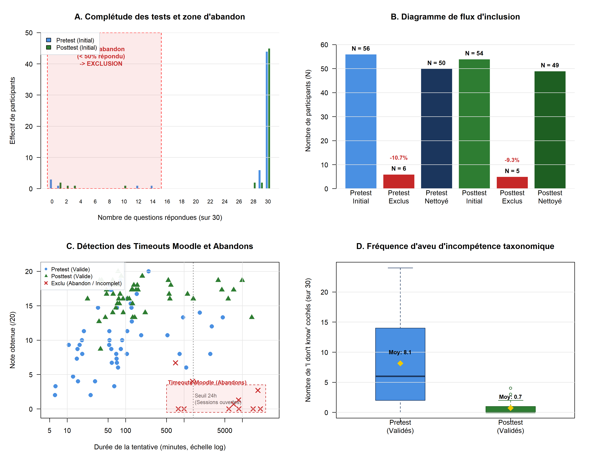{width=85%}

---

## 2. Axe A — Évaluation et dynamique de l'apprentissage taxonomique

### 2.1 Performances globales et gains d'apprentissage

##### Tableau 2A : Performances descriptives Pré vs Post et gains observés (scores sur 20 points)

| Cohorte & Année | Échantillon | Pré-test (Moy ± ET) | Post-test (Moy ± ET) | Gain brut ($\Delta$) | Gain relatif |
| :--- | :---: | :---: | :---: | :---: | :---: |
| **EPIC 2025** *(Adultes)* | 50 Pré / 49 Post | 10,51 ± 4,69 | 16,53 ± 2,22 | **+6,02 pts** | +30,1 % |
| **BAC 3 (2024)** *(Étudiants)* | 25 paires strictes | 6,61 ± 3,21 | 14,06 ± 2,76 | **+7,45 pts** | +37,2 % |
| **BAC 3 (2025)** *(Étudiants)* | 22 paires strictes | 9,33 ± 4,33 | 15,26 ± 2,64 | **+5,93 pts** | +29,7 % |
| **EPIC 2026** *(Transversal)* | 64 Formés / 108 Témoins | 15,91 ± 3,43 | 16,53 ± 2,77 | **+0,62 pt** | +3,1 % |

##### Tableau 2B : Tests statistiques inférentiels et tailles d'effet de l'apprentissage

| Cohorte & Année | Test inférentiel | Valeur $p$ | $d$ de Cohen | $r$ de Rosenthal | Odds Ratio ajusté [IC 95 %] |
| :--- | :--- | :---: | :---: | :---: | :---: |
| **EPIC 2025** | Wilcoxon Mann-Whitney ($W = 2103$) | $< 0,001$ | 1,64 | 0,62 | **3,94** [2,74 - 5,66] |
| **BAC 3 (2024)** | Wilcoxon apparié ($V = 325$) | $< 0,001$ | 2,73 | 0,62 | **5,54** [3,77 - 8,14] |
| **BAC 3 (2025)** | Wilcoxon apparié ($V = 252$) | $< 0,001$ | 1,40 | 0,61 | **4,37** [2,73 - 6,98] |
| **EPIC 2026** | GLM multivarié ($t = -2,02$) | $0,046$ | 0,19 | 0,07 | **1,42** [1,01 - 2,01] |

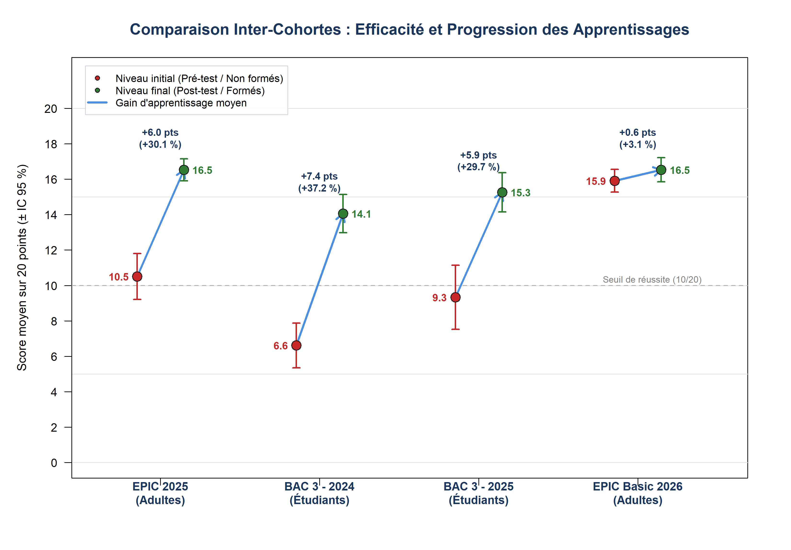{width=90%}

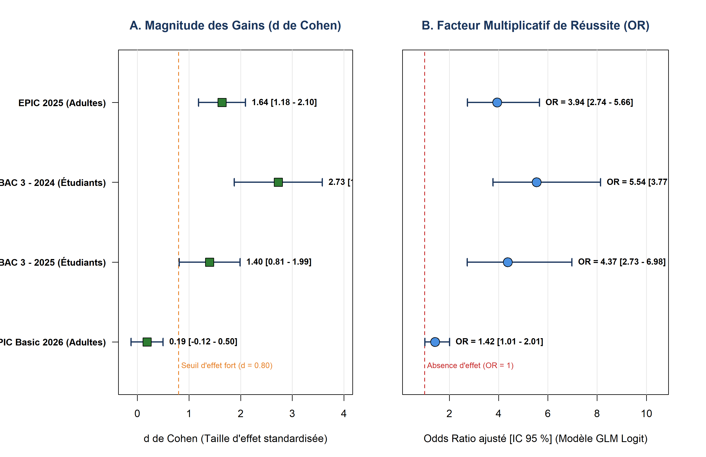{width=85%}

---

### 2.2 Analyse distributionnelle et homogénéisation des scores

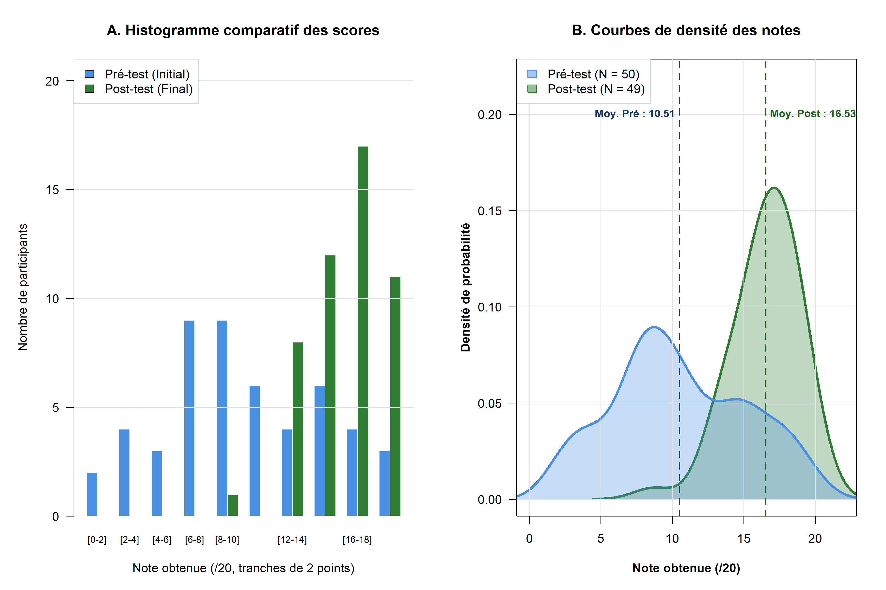{width=85%}

---

### 2.3 Déblocage cognitif : Résorption de la réponse d'évitement

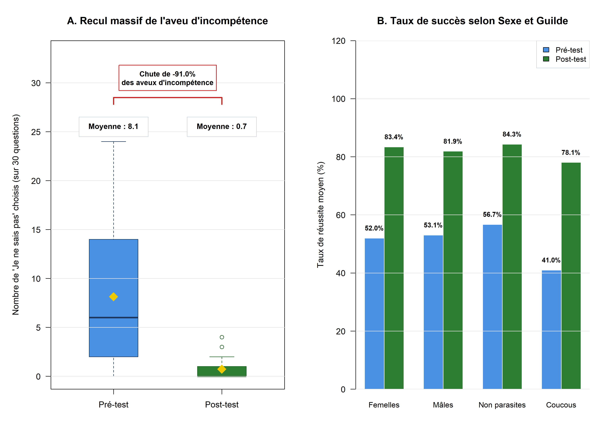{width=85%}

---

### 2.4 Variables médiatrices et facteurs biologiques

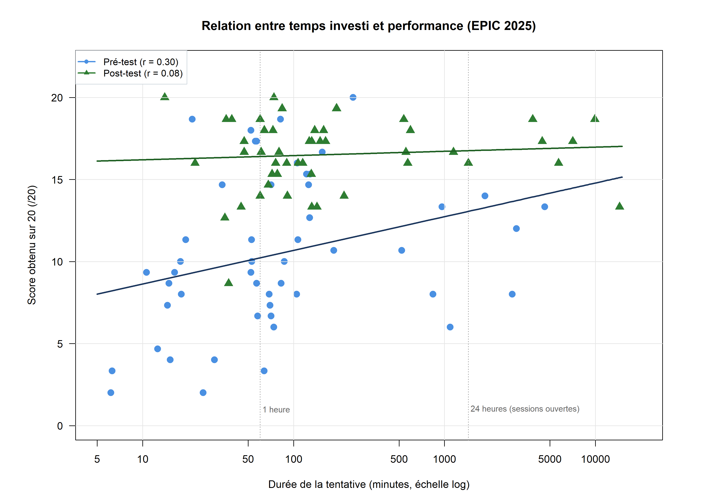{width=85%}

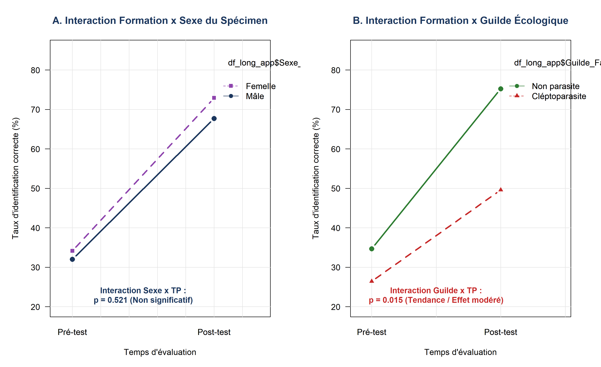{width=85%}

---

### 2.5 Modélisation comparative inter-cohortes (Interaction Public $\times$ Formation)

##### Tableau 3 : Modèle Linéaire Généralisé Quasibinomial testant l'interaction Public $\times$ Formation

| Terme du modèle | Coefficient ($\beta$) | Erreur Std | Statistique $t$ | Valeur $p$ | Odds Ratio [IC 95 %] |
| :--- | :---: | :---: | :---: | :---: | :---: |
| **Constante** *(Étudiants - Pré-test)* | -0,4295 | 0,1127 | -3,811 | $0,00019^{***}$ | 0,65 [0,52 - 0,81] |
| **Effet Public** *(Adultes EPIC)* | +0,5308 | 0,1554 | +3,417 | **$0,00078^{***}$** | **1,70** [1,25 - 2,31] |
| **Effet Formation** *(Post-test)* | +1,4297 | 0,1677 | +8,524 | **$< 10^{-14***}$** | **4,18** [3,01 - 5,80] |
| **Interaction** *(Adultes $\times$ Formation)* | +0,0299 | 0,2447 | +0,122 | **0,903 (NS)** | **1,03** [0,64 - 1,66] |

---

## 3. Axe B — Identification des genres pièges et analyse des confusions

### 3.1 Gradient consensuel de difficulté des 27 genres d'abeilles

##### Tableau 4 : Gradient consensuel de difficulté taxonomique des 27 genres évalués en Post-formation

| Catégorie | Genre | Famille | Guilde | Taux de succès | Taux d'erreur [IC 95 % Wilson] |
| :--- | :--- | :--- | :--- | :---: | :---: |
| **Très difficile** ($\ge 35\,\%$) | ***Stelis*** | Megachilidae | Cléptoparasite | 42,6 % | **57,4 %** [43,3 - 70,5 %] |
| | ***Trachusa*** | Megachilidae | Non parasite | 45,5 % | **54,5 %** [34,7 - 73,1 %] |
| | ***Anthophora*** | Apidae | Non parasite | 46,9 % | **53,1 %** [43,2 - 62,8 %] |
| | ***Lasioglossum*** | Halictidae | Non parasite | 54,2 % | **45,8 %** [37,0 - 54,7 %] |
| | ***Megachile*** | Megachilidae | Non parasite | 57,0 % | **43,0 %** [34,5 - 51,9 %] |
| | ***Sphecodes*** | Halictidae | Cléptoparasite | 57,8 % | **42,2 %** [35,4 - 49,3 %] |
| | ***Chelostoma*** | Megachilidae | Non parasite | 61,2 % | **38,8 %** [26,4 - 52,8 %] |
| **Difficulté modérée** (20 - 34 %) | ***Andrena*** | Andrenidae | Non parasite | 69,8 % | **30,2 %** [24,2 - 37,0 %] |
| | ***Osmia*** | Megachilidae | Non parasite | 71,9 % | **28,1 %** [20,1 - 37,8 %] |
| | ***Ammobates*** | Apidae | Cléptoparasite | 73,5 % | **26,5 %** [16,2 - 40,3 %] |
| | ***Eucera*** | Apidae | Non parasite | 78,0 % | **22,0 %** [15,5 - 30,3 %] |
| | ***Hoplitis*** | Megachilidae | Non parasite | 79,6 % | **20,4 %** [11,5 - 33,6 %] |
| | ***Melecta*** | Apidae | Cléptoparasite | 79,6 % | **20,4 %** [11,5 - 33,6 %] |
| **Accessible** (10 - 19 %) | ***Nomada*** | Apidae | Cléptoparasite | 81,2 % | **18,8 %** [13,9 - 24,9 %] |
| | ***Epeolus*** | Apidae | Cléptoparasite | 81,6 % | **18,4 %** [10,0 - 31,4 %] |
| | ***Panurgus*** | Andrenidae | Non parasite | 82,3 % | **17,7 %** [11,4 - 26,5 %] |
| | ***Anthidium*** | Megachilidae | Non parasite | 85,4 % | **14,6 %** [8,9 - 23,0 %] |
| | ***Colletes*** | Colletidae | Non parasite | 85,4 % | **14,6 %** [8,9 - 23,0 %] |
| | ***Ceratina*** | Apidae | Non parasite | 88,5 % | **11,5 %** [6,5 - 19,4 %] |
| | ***Macropis*** | Melittidae | Non parasite | 89,8 % | **10,2 %** [4,4 - 21,8 %] |
| **Facile** ($< 10\,\%$) | ***Coelioxys*** | Megachilidae | Cléptoparasite | 91,8 % | **8,2 %** [3,2 - 19,2 %] |
| | ***Halictus*** | Halictidae | Non parasite | 92,4 % | **7,6 %** [4,1 - 13,9 %] |
| | ***Hylaeus*** | Colletidae | Non parasite | 92,7 % | **7,3 %** [4,4 - 11,9 %] |
| | ***Bombus*** | Apidae | Non parasite | 94,0 % | **6,0 %** [3,5 - 10,0 %] |
| | ***Apis*** | Apidae | Non parasite | 95,8 % | **4,2 %** [1,6 - 10,2 %] |
| | ***Dasypoda*** | Melittidae | Non parasite | 95,8 % | **4,2 %** [1,6 - 10,2 %] |
| | ***Xylocopa*** | Apidae | Non parasite | 100,0 % | **0,0 %** [0,0 - 3,8 %] |

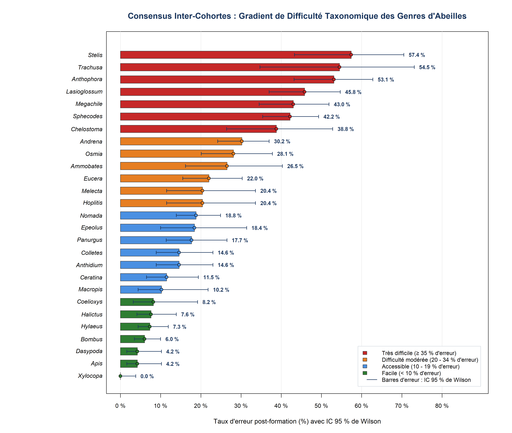{width=90%}

---

### 3.2 Modélisation logistique de la difficulté par genre

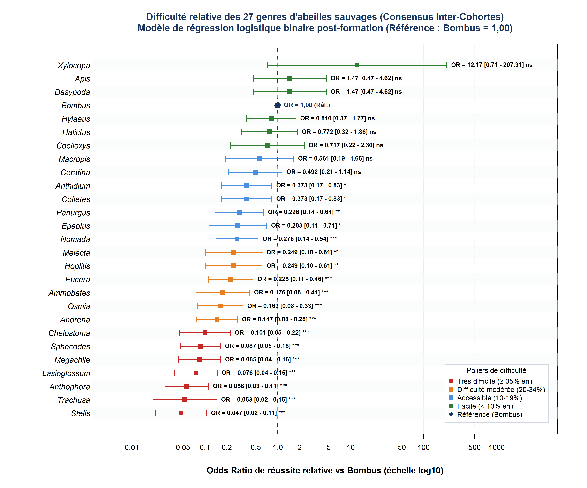{width=90%}

---

### 3.3 Déblocages diagnostiques et gains significatifs par genre

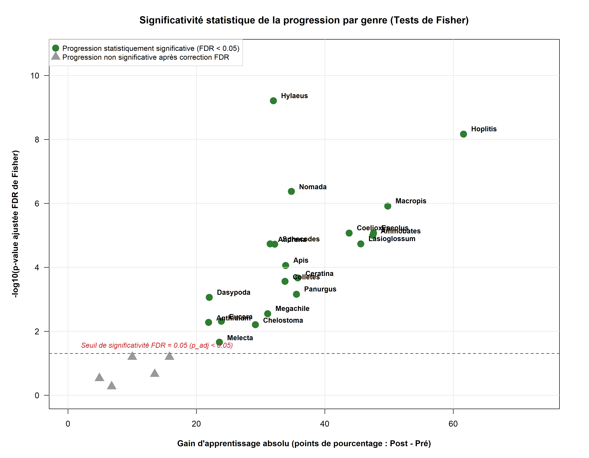{width=85%}

---

### 3.4 Patrons des confusions taxonomiques majeures

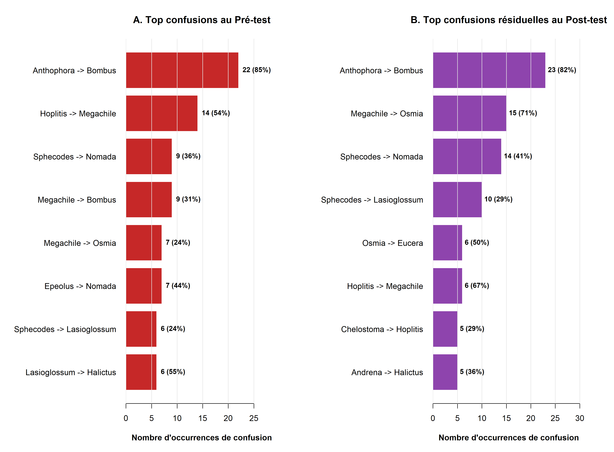{width=85%}

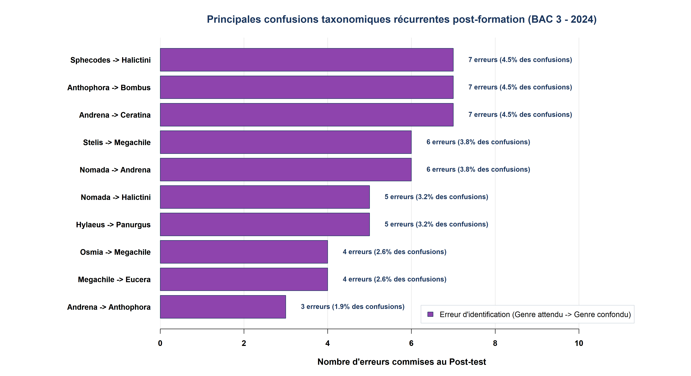{width=85%}

##### Tableau 5 : Principales confusions taxonomiques et critères morphologiques discriminants

| Cible $\to$ Genre confondu | Part des erreurs | Familles | Critère morphologique discriminant source d'erreur |
| :--- | :---: | :--- | :--- |
| ***Sphecodes* $\to$ *Nomada*** | **58,3 %** | Halictidae $\to$ Apidae | Abdomen rouge et corps noir glabre ; nervation alaire (nervure basale coudée chez *Sphecodes*). |
| ***Anthophora* $\to$ *Bombus*** | **44,1 %** | Apidae $\to$ Apidae | Allure trapue et toison dense ; patte III (scopa velue chez *Anthophora* vs corbicula chez *Bombus*). |
| ***Lasioglossum* $\to$ *Halictus*** | **36,7 %** | Halictidae $\to$ Halictidae | Taille et habitus proches ; soies abdominales (bandes basales chez *Lasioglossum* vs apicales chez *Halictus*). |
| ***Megachile* $\to$ *Osmia*** | **31,2 %** | Megachilidae $\to$ Megachilidae | Brosse ventrale commune ; cuticule (sombre chez *Megachile* vs reflets métalliques chez *Osmia*). |
| ***Stelis* $\to$ *Anthidium*** | **28,9 %** | Megachilidae $\to$ Megachilidae | Macules jaunes sur fond noir ; absence de brosse ventrale chez *Stelis* (cléptoparasite). |

---

## 4. Tableau synoptique de synthèse

##### Tableau 6 : Tableau synoptique récapitulatif des indicateurs clés du mémoire

| Axe | Dimension | Indicateur statistique majeur | Valeur observée |
| :--- | :--- | :--- | :---: |
| **Axe A** | Progression globale | Gain brut moyen ($\Delta$) sur 20 points | **+5,93 à +7,45 pts** |
| **Axe A** | Amplitude de l'effet | Taille d'effet de Rosenthal ($r$) | **$r \approx 0,61 - 0,62$** |
| **Axe A** | Cote de réussite | Odds Ratio GLM Formation | **$\text{OR} = 3,94 - 5,54$** |
| **Axe A** | Vitesse d'apprentissage | Interaction Public $\times$ Formation | **$p = 0,903$ (NS)** |
| **Axe A** | Doute / Évitement | Réduction du « Je ne sais pas » | **-85,3 % à -92,2 %** |
| **Axe A** | Facteurs biologiques | Interaction Sexe $\times$ Formation | **$p = 0,393$ (NS)** |
| **Axe B** | Difficulté extrême | Genre le plus résistant | ***Stelis* (57,4 % err)** |
| **Axe B** | Confusion majeure | Paire d'erreur prédominante | ***Sphecodes* $\to$ *Nomada* (58,3 %)** |
| **Axe B** | Maîtrise totale | Genre le plus facile | ***Xylocopa* (0,0 % err)** |
